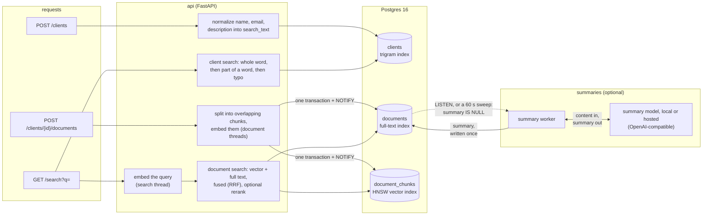

# Nevis Search API

Search across advisor clients and their documents: clients by name, email or description
(including part of a word), documents by meaning as well as words. Built as the Nevis home
assignment.

FastAPI and Postgres 16, which also does the searching: `pg_trgm` for clients, full-text search
plus `pgvector` for documents. Embeddings come from a local model baked into the image; optional
summaries come from a separate worker service. Why these, and the trade-offs:
[`decisions.md`](decisions.md).

## Reviewer's path

1. [Quick start](#quick-start), then the [examples](#examples) or the Swagger UI.
2. [How it fits together](#how-it-fits-together): one diagram of the data flow.
3. The code, in request order:
   - [`search/service.py`](src/nevis/search/service.py) runs the two searches;
     [`search/clients.py`](src/nevis/search/clients.py) and
     [`search/documents.py`](src/nevis/search/documents.py) are their SQL.
   - [`documents/repository.py`](src/nevis/documents/repository.py): the write path (embed,
     then one transaction).
   - [`summaries/worker.py`](src/nevis/summaries/worker.py): the optional summary worker.
   - [`tests/test_search.py`](tests/test_search.py): search behaviour as examples.
4. [`decisions.md`](decisions.md): why, with measurements and trade-offs.

Safe to skip: `deploy/` and `.github/workflows/deploy.yml` (the deployed server), `scripts/`
(end-to-end and relevance tooling) and `schema/migrations/` (generated).

## Quick start

Needs Docker. [`just`](https://just.systems) runs the everyday commands; plain `docker compose`
works too.

```sh
just up    # or: docker compose up --build --detach --wait
```

Then open the Swagger UI at http://localhost:8000/docs (OpenAPI at `/openapi.json`). Port 8000
taken? Set `API_PORT` in `.env` (see `.env.example`); the examples below assume 8000.

The first build downloads the embedding models (about 150 MB) into the image; after that the
stack starts without network access. `just down` stops everything; data stays in `.data/` until
`just clean`.

## API

| Method and path | Does | Success | Errors |
|---|---|---|---|
| `POST /clients` | Create a client | 201 | 409 email taken (case-insensitive), 422 |
| `GET /clients/{id}` | Read a client | 200 | 404, 422 |
| `POST /clients/{id}/documents` | Add a document to a client | 201 | 404 unknown client, 422 |
| `GET /documents/{id}` | Read a document (with its summary, once there is one) | 200 | 404, 422 |
| `GET /search?q=` | Search clients, then documents | 200 | 422 |
| `GET /health`, `GET /health/ready` | Liveness; readiness (Postgres reachable) | 200 | 503 (ready) |

`GET /search` takes `q` (1–200 characters), `clients_limit` (0–50, default 10) and
`documents_limit` (0–20, default 5). It returns clients first, then documents; a document hit
carries the document without its content (read that with `GET /documents/{id}`) and the chunk
that matched best. Endpoints return 503 when Postgres is unreachable; a document upload also
returns 503, with `Retry-After`, when too many documents are already waiting to be embedded.
Errors other than 422 have the body `{"detail": "<message>"}`. Full schemas and examples are in
the Swagger UI.

**Search is consistent immediately:** a client or document is searchable as soon as its `POST`
returns.

## Examples

Responses below are real, from a fresh stack; long fields are trimmed with `…`.

### Create a client and a document

```sh
curl -s -X POST localhost:8000/clients -H 'Content-Type: application/json' -d '{
  "first_name": "John", "last_name": "Doe", "email": "john.doe@neviswealth.com",
  "description": "Prefers sustainable funds; retiring in 2030",
  "social_links": ["https://www.linkedin.com/in/johndoe"]
}'
```

```json
{
  "id": "d6276f90-1efc-407e-bfc1-aa13e62f2f73",
  "first_name": "John",
  "last_name": "Doe",
  "email": "john.doe@neviswealth.com",
  "description": "Prefers sustainable funds; retiring in 2030",
  "social_links": ["https://www.linkedin.com/in/johndoe"]
}
```

```sh
curl -s -X POST localhost:8000/clients/d6276f90-1efc-407e-bfc1-aa13e62f2f73/documents \
  -H 'Content-Type: application/json' -d '{
  "title": "Utility bill March",
  "content": "Electricity utility bill from Vattenfall for the apartment at 12 Lake Road, Zurich. Billing period March 2026, amount due CHF 84.20."
}'
```

```json
{
  "id": "7ecff0f7-f31b-48f1-8650-0d208e236b98",
  "client_id": "d6276f90-1efc-407e-bfc1-aa13e62f2f73",
  "title": "Utility bill March",
  "content": "Electricity utility bill from Vattenfall for the apartment at 12 Lake Road, …",
  "summary": null,
  "created_at": "2026-10-11T05:11:26.581794Z"
}
```

The examples below also use two more clients (Zoë McAllister, and Anna Schmidt whose
description says "Referred by NevisWealth") and two more documents of John's ("Passport scan",
"Tax return 2025").

### Find a client by email: `NevisWealth`

```sh
curl -s 'localhost:8000/search?q=NevisWealth&documents_limit=2'
```

```json
[
  {"type": "client", "client": {"id": "d6276f90-…", "first_name": "John", "last_name": "Doe",
    "email": "john.doe@neviswealth.com", "description": "Prefers sustainable funds; …", "social_links": ["…"]}},
  {"type": "client", "client": {"id": "d6cdd3c5-…", "first_name": "Anna", "last_name": "Schmidt",
    "email": "anna@weberfamilyoffice.de", "description": "Referred by NevisWealth", "social_links": []}},
  {"type": "document", "document": {"id": "7ecff0f7-…", "client_id": "d6276f90-…",
    "title": "Utility bill March", "summary": null, "created_at": "2026-10-11T05:11:26.581794Z"},
    "matched_text": "Electricity utility bill from Vattenfall for the apartment at 12 Lake Road, …"},
  {"type": "document", "document": {"id": "2aa33ad1-…", "title": "Passport scan", "…": "…"},
    "matched_text": "Scanned copy of the client's Swiss passport, issued 2021, valid until 2031."}
]
```

Clients come first: whole-word matches, then ones containing the text inside a word, then
typos. Case and accents don't matter. `wealth` also finds John (inside `neviswealth`) and Anna,
and so does the typo `neviswelth`.

### Find documents by meaning: `address proof`

```sh
curl -s 'localhost:8000/search?q=address%20proof&documents_limit=2'
```

```json
[
  {"type": "document", "document": {"id": "2aa33ad1-…", "title": "Passport scan", "…": "…"},
    "matched_text": "Scanned copy of the client's Swiss passport, issued 2021, valid until 2031."},
  {"type": "document", "document": {"id": "7ecff0f7-…", "title": "Utility bill March", "…": "…"},
    "matched_text": "Electricity utility bill from Vattenfall for the apartment at 12 Lake Road, …"}
]
```

The utility bill is found although it contains neither word.

### Errors

```sh
curl -s -X POST localhost:8000/clients -H 'Content-Type: application/json' \
  -d '{"first_name": "John", "last_name": "Doe", "email": "John.Doe@NevisWealth.com"}'
# 409 {"detail": "A client with this email already exists"}
```

## How it fits together



Embedding happens before the transaction, so a document is searchable as soon as its `POST`
returns. Searches embed on a thread of their own and never wait behind a long document.

## How search works

- **Clients:** name, email and description are stored transliterated to ASCII and lowercased
  (`search_text`, with `anyascii`), so case and accents don't matter and `ivan` finds `Иван`.
  Matches containing the query as a whole word come first, then ones containing it inside a word,
  then typos (`pg_trgm` word similarity of at least 0.5). Queries shorter than three characters
  match whole words only.
- **Documents:** content is split into overlapping chunks, each embedded with
  `BAAI/bge-small-en-v1.5`. The chunks nearest to the query (pgvector) and the documents
  containing any of its words (Postgres full-text search, English stemming, ranked relative to
  document length) are merged by reciprocal rank fusion. One result per document, with its closest chunk as `matched_text`.
  A cross-encoder can rerank the top 20 (`NEVIS_SEARCH_RERANK=true`; off by default, see
  `decisions.md`).
- **Limits, not cutoffs:** semantic search always has a "closest" document, so `documents_limit`
  (default 5) bounds the list; there is no relevance score in responses (see `decisions.md`).
- **Consistency:** a document's chunks are embedded before its transaction and committed with
  it, so there is no indexing step to wait for.

## Summaries (optional)

Documents get a `summary` only if a model with an OpenAI-compatible chat API is configured;
otherwise it stays `null`. The `worker` service writes summaries (the api never calls the model),
so the settings are the worker's. The model can run locally, so documents never leave the
machine, or at a hosted provider. With [Ollama](https://ollama.com) on the host:

```sh
ollama pull llama3.2
cat >> .env <<'ENV'
NEVIS_SUMMARY_API_URL=http://host.docker.internal:11434/v1
NEVIS_SUMMARY_MODEL=llama3.2
ENV
just up
```

On Linux, start Ollama with `OLLAMA_HOST=0.0.0.0` so the worker container can reach it.

A hosted provider with an OpenAI-compatible endpoint (OpenAI, OpenRouter, Groq, Mistral, and
Gemini's or Anthropic's compatibility endpoints) takes its base URL, a model id and an API key,
sent as a Bearer token. This sends document content (up to 12k characters each) to that
provider:

```sh
cat >> .env <<'ENV'
NEVIS_SUMMARY_API_URL=https://api.openai.com/v1
NEVIS_SUMMARY_MODEL=<the provider's model id>
NEVIS_SUMMARY_API_KEY=<your API key>
ENV
just up
```

The summary appears shortly after the document is created: `GET /documents/{id}`. Without the
settings, the worker logs one line and idles (`just logs worker`).

## Development

| Command | Does |
|---|---|
| `just test [pytest args]` | Full test suite in Docker (separate, in-memory stack; 80% coverage gate) |
| `just exercise [--model ID] [--keep]` | Every endpoint and the summary worker end to end, on a throwaway stack with a local model (default LM Studio on `127.0.0.1:1234`; see `scripts/exercise.sh`) |
| `just relevance` | Search relevance on a throwaway stack: 58 labelled queries over 48 documents in five domains, reported as hit@1, hit@3 and MRR (`scripts/relevance.py`) |
| `just check` | Ruff lint and format check, mypy (strict) |
| `just infra`, then `just run` | Infrastructure in Docker, api on the host (to debug it) |
| `just migration <name>` | Generate a migration from `schema/schema.sql` (and the row models) |
| `just reembed [--all]` | Embed documents that have no chunks yet (`--all`: every document, after changing the embedding model) |
| `just logs [service]` | Follow the logs of the stack, or of one service (e.g. `worker`) |
| `just down`, `just clean` | Stop; delete dev data |

Needs [uv](https://docs.astral.sh/uv/) for the host commands (`uv sync`). Configuration is
read from `NEVIS_*` environment variables; `.env.example` lists the compose overrides.

The api records which embedding model produced the stored vectors and refuses to start when the
code embeds with another one: after changing `EMBEDDING_MODEL`, run `just reembed --all`.

## Deployment

Releases and deploys run on GitHub Actions; one-time server setup:
[`deploy/bootstrap.md`](deploy/bootstrap.md).

- **Release:** a push to `main` that passes every check (lint and types, tests, and
  `just prod-smoke`, a smoke test of the production stack) pushes the images to ghcr.io and
  publishes release `v<version>` with the version from `pyproject.toml`. Bump it to release again.
- **Deploy:** Actions → Deploy → Run workflow, with a version (default: the latest release). Over
  SSH it has [`deploy/deploy.sh`](deploy/deploy.sh) pull the images and back up the database on
  the server, applies the migrations from CI through a tunnel
  ([`deploy/migrate.sh`](deploy/migrate.sh); the server has no Atlas), then starts the release and
  checks it. A rollback is a deploy of an older version.
- **On the server:** [`deploy/compose.prod.yml`](deploy/compose.prod.yml) runs Postgres, the api
  and the worker from the release images, behind Caddy. Caddy serves `https://<server ip>` with a
  Let's Encrypt certificate for the IP address (no domain needed), requires Basic auth on
  everything except `/health`, rate-limits each client and caps request bodies at 1 MB.
